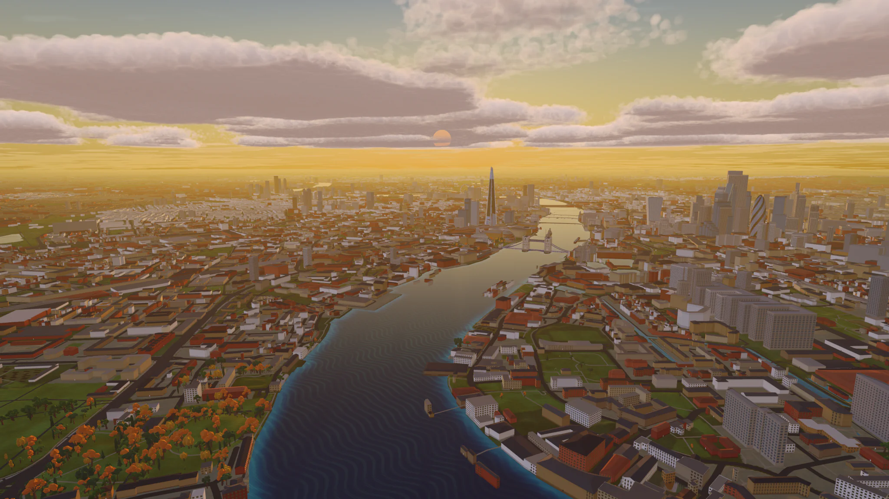
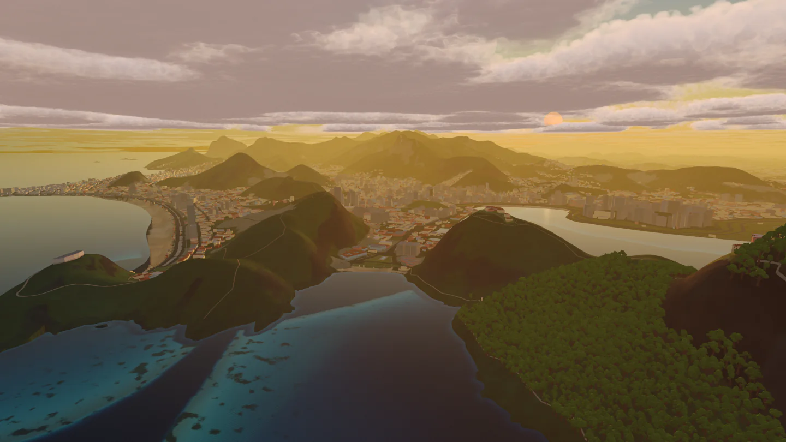
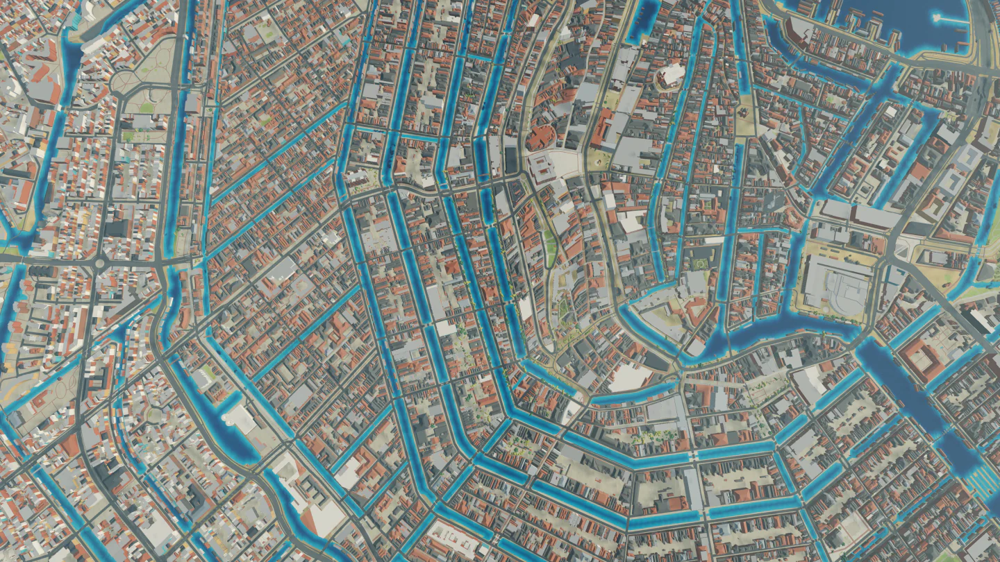
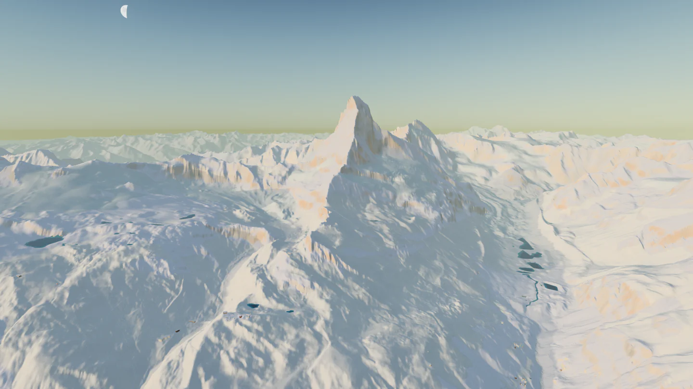
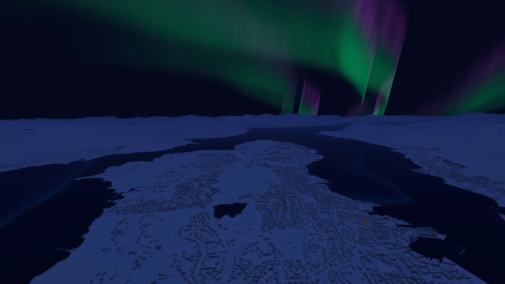
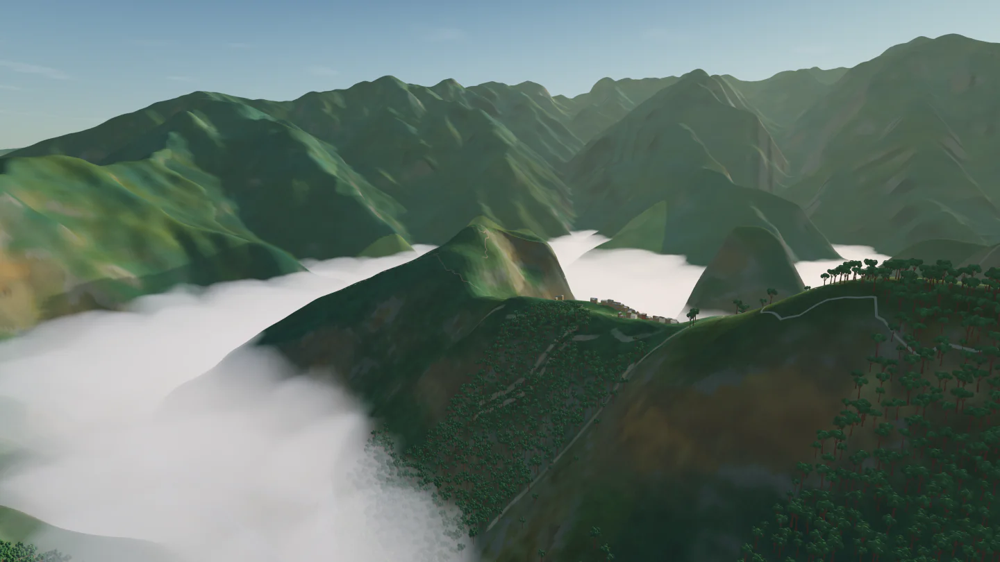
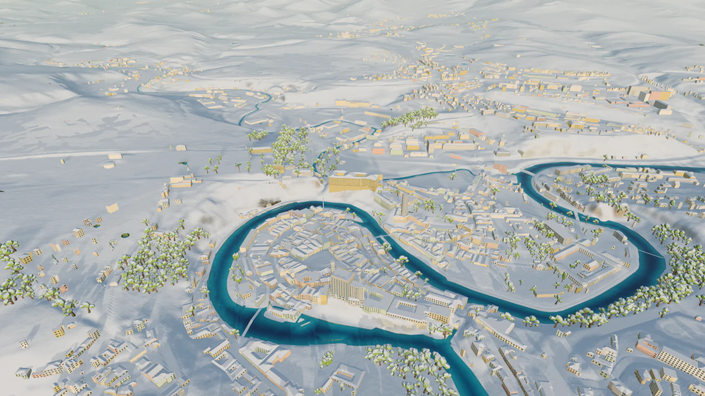
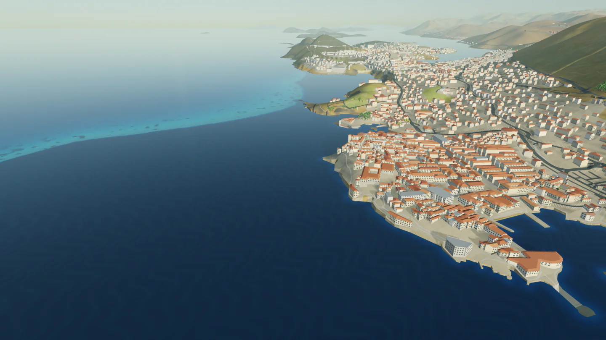
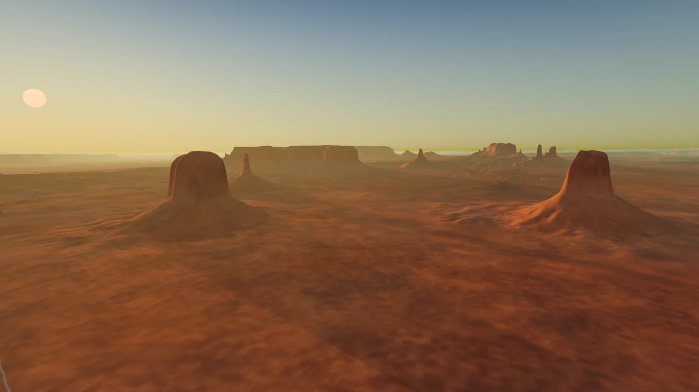

# Low Poly Earth

The whole Earth in 3D, built from open map and elevation data. Pan and zoom
from orbit to street level, fly over any place on the planet, and photograph
it at any date, time and weather.

## Download

**[Download Low Poly Earth for Mac](https://github.com/BlueBlazin/lowpolyearth/releases/latest/download/Low-Poly-Earth-Apple-Silicon.dmg)**
(free, about 640 MB)

- Requires a Mac with Apple silicon and macOS 13 or later.
- Open the disk image and drag Low Poly Earth to Applications. The app is
  signed and notarized by Apple.
- An internet connection is needed for full detail. Buildings, roads, water and
  fine terrain stream from online map and elevation sources.

Release notes and checksums are on the [releases page](https://github.com/BlueBlazin/lowpolyearth/releases).

## Screenshots

Every image is an unedited capture from the app.

<table>
  <tr>
    <td> Rio de Janeiro, Brazil</td>
    <td> Amsterdam, the Netherlands</td>
  </tr>
  <tr>
    <td> Matterhorn, Switzerland</td>
    <td> Tromsø, Norway</td>
  </tr>
  <tr>
    <td> Machu Picchu, Peru</td>
    <td> Český Krumlov, Czechia</td>
  </tr>
  <tr>
    <td> Dubrovnik, Croatia</td>
    <td> Monument Valley, United States</td>
  </tr>
</table>

More photographs are on [the website](https://lowpolyearth.pages.dev/screenshots.html).

## What it does

- **Explore:** search for any place by name or pick it on the world map, and
  the camera flies there.
- **Fly:** press P to take off in one of the flyable vehicles.
- **Photograph:** set the date, time and weather, and save the view as a 4K
  image.
- **Light and weather:** the sun, moon, stars and aurora follow the real date,
  time and location, with simulated clouds, rain, snow and fog.
- **Landmarks:** 231 landmarks are modelled individually.

## Feedback

Found a bug or a place that looks wrong? [Open an issue](https://github.com/BlueBlazin/lowpolyearth/issues)
with the location and, if you can, a screenshot. You can also write to
contact.urbanphilosophy@gmail.com.

## Data sources

Elevation: [Mapterhorn](https://mapterhorn.com/attribution) (Copernicus GLO-30
and national elevation models), [USGS 3DEP](https://www.usgs.gov/3d-elevation-program),
[Environment Agency LiDAR](https://environment.data.gov.uk/) (Open Government
Licence v3). Map data © [OpenStreetMap contributors](https://www.openstreetmap.org/copyright)
(ODbL), via [Protomaps](https://protomaps.com/). Imagery: [NASA Blue Marble](https://science.nasa.gov/earth/earth-observatory/blue-marble-next-generation/base-map/),
[NSW Spatial Services](https://www.spatial.nsw.gov.au/) (CC BY 4.0). Also
GeoNames, Wikidata, Natural Earth, WorldClim, JRC GHS-SMOD, Timezone Boundary
Builder, ESA Hipparcos (CC BY-NC 3.0 IGO) and ESO/S. Brunier.

The app lists every source and licence in its attribution window, and ships
full third-party notices inside the app bundle.

Low Poly Earth is free. It is not open source; this repository hosts releases,
screenshots and issue reports.
